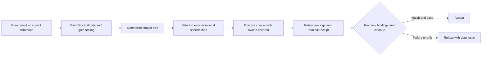

# Implementation Plan: Native Local Validation

**Branch**: `codex/native-local-validation` | **Date**: October 12, 2026 | **Spec**: [spec.md](spec.md)

Status: Planned architecture; implementation, independent acceptance, and hosted retirement remain open. Planning writes target this branch; the ready PR targets `fix/owned-analysis-implementation`. Compatible starting revision: `6e1dd8d14fbd5cb916a966cc1d13c8b5f06797b2`.

## Summary

A Zig 0.16 gate validates the exact proposed commit in an isolated staged-tree snapshot. One versioned JSON specification owns routing, command dependencies, modes, and execution budgets. Existing Python validators remain behavioral authorities. Retain complete produced diagnostics privately, show bounded excerpts, join owned processes, and recheck every relevant input before accepting. Retire hosted execution only after selection and behavior equivalence, local publication support, and guidance reconciliation.

## Technical Context

**Language/Version**: Zig 0.16.0 for selection, staged-tree orchestration, execution, and receipts; existing Python support range remains unchanged.
**Primary Dependencies**: Git, the existing frozen Python environment, pytest, Ruff, strict mypy, coverage, diff-cover, and existing docs, architecture, completion, and release validators. No new package dependency is selected by this plan.
**Storage**: Versioned JSON gate specification; private per-invocation candidate snapshots, JSON receipts, and raw `.log` diagnostics outside tracked source.
**Testing**: Committed RED acceptance controls before implementation; focused native and shell integration controls, existing affected Python tests, and at least 90% changed executable statement coverage with explicit native instrumentation evidence.
**Target Platform**: Darwin first, with separately qualified Linux and Windows execution. Unsupported platforms refuse; Darwin evidence does not qualify the hosted Linux or Windows matrix.
**Project Type**: Repository-local tooling, hook integration, and migration of existing validation consumers.
**Performance Goals**: Measure actual gate elapsed time and repeated work; no latency or savings claim without a comparable baseline. Existing workflow timeout values seed finite command budgets, which actual controls qualify.
**Constraints**: Preserve exact staged files, existing work, branch/planning guards, user hooks, publication, and validation thresholds. No canonical corpus, Source/Store, or model effects. Use the already owned checkout; no additional worktree.
**Scale/Scope**: Replace this fork's hosted execution through explicit local commit, full, platform, release, packaging, and documentation publication modes.

## Engineering Alignment

Sam has authorized autonomous implementation and local native validation. Routine questions are resolved from the specification and existing authorities. The proposed commit is the authority, not the working directory. Unknown inputs, incomplete bindings, missing required tools, failing checks, and unfinished cleanup refuse. The independent workflow owner reviews the fixed candidate and equivalence evidence. No fresh human enrollment or approval ceremony is added.

## Charter Check

Preserve single canonical authority, ATDD-first, strict type and formatting checks, non-vacuous architecture controls, independently owned review, public finding disposition, and staged-work preservation. Sam's explicit local migration direction supersedes inherited hosted-only execution assignments; update those assignments only in the qualified retirement increment. Do not add allowlists or lower thresholds. Scoped cleanup precedes functional edits to touched complex surfaces. Existing routing is a migration oracle, not a permanent second map.

## Architecture And Flow

The hook is a thin launcher to the same public entry. The launcher is trusted only when its bytes, native executable, native source, and specification match the staged candidate and qualified build inputs. Compile from the candidate when tooling changes; never let unstaged launcher or gate changes select a different candidate's checks.

Git plumbing identifies the actual repository, common directory, index, staged tree, HEAD, and explicit base. Materialize tracked candidate blobs and modes into a private non-worktree snapshot, preserving path bytes and executable modes. Reject unsupported gitlinks or unsafe escapes explicitly. Retain linked-worktree topology and provide an isolated private Git context where validators require it; never register another operational worktree or modify the live index to build the fixture. Validators importing first-party code must import candidate source rather than an editable environment's live checkout. Reuse dependencies only with locked and observed identity, and run with a declared environment allowlist.

Recheck tree, HEAD/base, specification, tooling, dependencies, and relevant environment after all checks and cleanup, immediately before hook success. Concurrent invocations have distinct resources and a repository/index-scoped admission lock. An unsupported or changed input refuses; a receipt is proof, not a reservation against subsequent external mutation. Test the actual Git commit path and document Git's final acceptance boundary honestly.

## One Routing Authority

Extract `scripts/ci/gate_selection.py`'s current path/group/job relationships, `.github/ci-module-registry.yml` module inventory, and actual workflow commands into `tools/validation/gates.json`. Preserve source provenance and discriminating migration controls. Native selection uses argv arrays and explicit dependency edges, never shell interpolation of changed paths. Update existing Python parity and completeness consumers to read the local authority; delete their runtime dependence on workflow YAML before retirement. During transition, generate hosted routing from the same specification or freeze the migration oracle without maintaining two editable maps.

Unknown surfaces select the supported conservative gate or refuse. Always-on checks remain selected. A failed dependency cannot silently skip a required terminal gate. Selection exposes check IDs and reasons without launching publication.

## Execution And Diagnostic Ownership

Reuse the reviewed Temet `tools/zig/owned_process_group.zig` from revision `7d99ede611abbbfbda4503471fa71b417a6ef177`, SHA-256 `16dbf37d5d9199e61523e731cf931404e695d7a37fec463519951ba0a26fff8b`, as the Darwin ownership foundation. It currently bounds in-memory captures and supports Darwin only. Adapt a streaming log sink in a separately tested step; preserve kernel identity checks, cancellation, and joined cleanup. Do not pretend its existing capture contract already provides complete large diagnostic logs or cross-platform supervision.

The versioned specification declares finite wall, cleanup, output, process, and memory budgets for each check. Retain every produced byte up to the declared execution quota in private raw logs; excerpts have a separate display limit. A quota breach terminates the owned run, retains produced evidence, and refuses explicitly. No truncation may yield a passing receipt. Retention and cleanup policies remove only terminal, owned resources; incomplete cleanup remains a failure with a recoverable path.

## Project Structure

Planned new surfaces: `tools/validation/gates.json`, `tools/zig/local_validation.zig`, focused candidate/selection/receipt/process modules under `tools/zig/`, a thin launcher under `scripts/validation/`, integration fixtures under `tests/local_validation/`, and a documented pre-commit integration preserving existing hook customizations. Reuse `scripts/git-hooks/pre-commit-task-workflow.sh` guards where applicable. Existing consumers in `scripts/ci/`, `tests/ci/`, and `tests/architectural/` migrate to the local authority. Exact ownership paths are finalized by actual tasks before implementation.

Mission artifacts: this plan, `research.md`, `data-model.md`, `contracts/local-validation.md`, `quickstart.md`, and sparse `traces/` files. The independently owned implementation log is `docs/plans/engineering-notes/2026-10-12-native-local-validation.md`.

## Implementation Concern Map

### IC-01 — Canonical specification and selection

- Purpose: Extract actual routing, commands, modes, and required qualification from pinned current authorities.
- Relevant requirements: FR-003, FR-009, FR-010, NFR-003.
- Affected surfaces: Local specification, current workflow/registry parser, parity consumers, and selection controls.
- Sequencing/depends-on: None.
- Risks: Missing command, platform, fork guard, conditional, or publication semantics; preserve rather than guess.

### IC-02 — Candidate and proof identity

- Purpose: Materialize and bind the exact staged candidate, tooling, dependencies, and environment.
- Relevant requirements: FR-002, FR-005, FR-006, FR-008, NFR-001.
- Affected surfaces: Native Git/candidate and receipt modules, partial-staging and linked-worktree fixtures.
- Sequencing/depends-on: Specification shape from IC-01.
- Risks: Editable imports, symlinks, unusual paths, index races, and stale gate binaries.

### IC-03 — Native execution and diagnostics

- Purpose: Execute selected validators with bounded ownership, complete produced logs, and joined terminal cleanup.
- Relevant requirements: FR-004, FR-007, NFR-002, NFR-005.
- Affected surfaces: Native process adapter and execution controls.
- Sequencing/depends-on: IC-01 and IC-02.
- Risks: Reused PID, surviving descendants, exhausted diagnostics, and unsupported platform claims.

### IC-04 — Hook and qualified retirement

- Purpose: Wire the actual commit path and local qualification/publication modes, then retire hosted execution without losing requirements.
- Relevant requirements: FR-001, FR-008, FR-009, FR-010, NFR-004.
- Affected surfaces: Hook launcher, existing guards, local release/docs entry points, workflow retirement, guidance, and remote-requirement receipts.
- Sequencing/depends-on: IC-01 through IC-03 and independent equivalence review.
- Risks: User hook clobbering, obsolete required checks, packaging or docs loss, and unavailable required platforms.

## Validation And Rollout

Commit a real failing acceptance increment first. On shared fixtures, prove both accepted passing commits and rejected failing commits, partial staging in both directions, native tooling drift, candidate/base drift, malformed and missing tools, selection equivalence, linked worktrees, path handling, concurrency, cancellation, descendant cleanup, quota breach, and evidence reuse refusal. Run required affected architecture, completion, docs, format, type, and coverage gates. Retain immutable external candidate receipts; recording a pass must not modify the candidate.

Hosted retirement is the final implementation concern: independently review selection and actual validator behavior, qualify required platform/full/release modes, retain explicit packaging and documentation publication, refresh actual branch protection/rulesets, and reconcile governing guidance. A missing platform or publication credential is a named blocker for that qualification, not a reason to claim equivalence. Default-main integration and Temet adoption follow the owning review workflow and remain distinct from compatible-line delivery.

## Known Limitations

The numeric budgets and full extracted command matrix are implementation inputs to derive and test, not completed proof. The Darwin helper requires a streaming adaptation; Linux and Windows need qualified ownership backends. No native replacement, installed hook, hosted retirement, model improvement, or savings is claimed by this plan.
