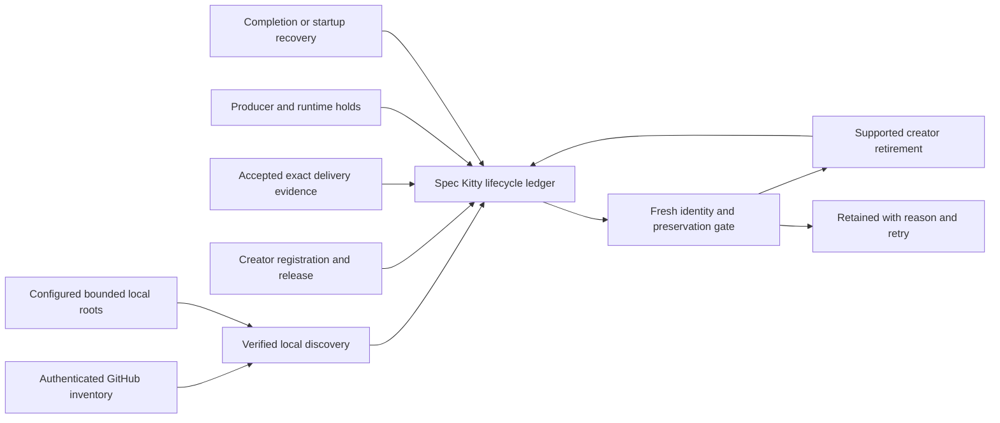

# Implementation Plan: Organization workspace lifecycle

## Summary and confirmed scope

Extend Spec Kitty’s existing orchestration tier with organization-wide discovery, durable lifecycle accounting, creator adapters and deterministic recovery. Preserve existing native Zig implementation and routing work. Current feature branch and planning/merge target are `codex/organization-workspace-lifecycle-20261020`; base is the published custody repair PR112. No local or remote main consolidation is permitted. This existing linked checkout owns all mission artifacts.

## Architecture

One domain decision consumes typed evidence; one application coordinator owns the lock, intent and result. Discovery never grants ownership or release. Creator adapters supply authority and shared holds. GitHub supplies delivery facts, not deletion authority. Completion and retirement are separately represented. Unknown creators and incomplete evidence are durably retained.

### Existing authorities to reuse

- `kernel.git.listing` and `kernel.git.worktree_registry` own NUL-safe Git inventory; do not introduce ad hoc path parsing.
- `kernel.locks.machine_file_lock` and `core.checkout_file_lock` own bounded local exclusion. Local locks do not establish distributed producer fencing.
- `git.destructive_guard.guarded_worktree_remove` remains the sole Git worktree removal choke point. Independent clones and managed workspaces must never fall through to it.
- Existing topology/checkout ownership validators resolve actual stores and primary checkouts. Folder names cannot prove identity or ownership.
- Existing Spec Kitty consolidation closeout supplies lane completion; extend event/accounting scope to non-lane creators without duplicating removal logic.

### Modules and slices

1. `workspace_lifecycle` domain/application package: immutable repository/workspace identities, typed disposition/reasons, policy, bounded local discovery and durable state. Export only wired production interfaces.
2. CLI lifecycle entry point: configured organization/root inventory, reconcile/status and creator event ingress. No raw secret values in state or command output. Pagination and failed repositories are explicit coverage.
3. Creator adapters: Spec Kitty and explicitly registered Git ownership first; Codex-managed identity is accounted for and only its supported archive interface may retire it. An unavailable creator produces retained status, never shell fallback. Connect supported completion and startup events to the same coordinator.
4. Branch-first consolidation correction and source guidance: feature/integration targets only until accepted PR delivery. Classify live vs historical occurrences before editing. Historical artifacts remain intact.
5. Integrated disposable acceptance and representative read-only inventory; any real retirement requires the complete creator evidence. No opportunistic backlog deletion.

## Supported Codex boundary

Official release documentation: https://learn.chatgpt.com/docs/hooks and https://developers.openai.com/plugins/build/plugins . SessionStart can request recovery; Stop ends a turn, not a mission; SessionEnd can occur on archive/close/idle and permits at most3seconds. SessionEnd therefore records a bounded event, not a repository scan or destructive action. Non-managed plugin hooks require the user to review/trust the concrete definition. Installation/enabling is not trust. Never bypass trust or write app databases. No supported general managed-worktree retirement API is established for an arbitrary background hook; retain those workspaces until the creator adapter can establish it.

## State and failure semantics

Store JSON machine state and Markdown human logs. Separate observe, intent, adapter result and current observation; an unknown adapter outcome stays unknown until verified. Writes use an existing durable JSON authority if present; otherwise introduce one tested minimal durable primitive, without overstating best-effort directory sync as durable success. Corrupt or symlinked state refuses mutation. Every intent binds repository/store/path/HEAD/branch, delivery identity, release generation and adapter identity. Replay checks identity, not only an event ID. Interrupted work is reconciled through creator inspection before retry. Failures produce a retained/failed disposition with a retry condition.

## Work packages and dependency order

| WP | Outcome | Requirements | Dependencies | Validation |
|---|---|---|---|---|
| WP01 | Verified org discovery and non-lane accounting | FR-001, FR-002 | none | Real Git stores/worktrees, URL identity, pagination, duplicates, missing roots/permissions, bounded errors |
| WP02 | Durable state and safe decision/replay coordinator | FR-002, FR-004, FR-005, FR-007, FR-008 | WP01 | Corruption, replay, path reuse, holds, release generations, unknown outcomes and concurrent intent |
| WP03 | Supported creator adapters and lifecycle ingress | FR-003, FR-004, FR-005, FR-008, FR-009 | WP02 | Real disposable retirement plus dirty/ignored/nested/active/primary preservation; managed creator refuses unsupported operation |
| WP04 | Branch-first consolidation and generated guidance | FR-006 | WP01 | Classified live occurrences, unchanged primary, feature integration/PR positive flow; preserve historical evidence |
| WP05 | Integrated startup/completion acceptance and closeout | all | WP01–WP04 | Supported event path, interruption recovery, representative org inventory, release/adoption instructions and independent review |

Each package is independently reviewed and delivered through a stacked PR; implementation remains in this existing checkout. No additional checkout is admitted. The repository merge owner owns merges; the implementer continues the next independently actionable slice while review is pending.

## Validation and evidence

Focused tests during iteration, `make test-fast` plus owning subsystem tests and the specific implicated architecture gates before publication. Diff executable statement coverage≥90percent, configured typing and Ruff. Red proof must expose the missing behavior and positive control must exercise production wiring. Freeze code/docs before final gates; receipts live outside the candidate. Do not repeat identical required gates merely to narrate progress. No suite filter or trust policy weakening.

## Typical-project latency acceptance

The charter budget is less than 2 seconds per local CLI interaction, distinct from the host SessionEnd ceiling of 3 seconds. WP03 provides local status/event enqueue and bounded background scan dispatch; synchronous `doctor organization-workspaces` remains an explicit foreground diagnostic, not the automatic event callback. WP05 measures process-start-to-exit wall time (including interpreter/import startup, excluding one-time installation) for status and enqueue with one local repository, three registered workspaces and 100 settled ledger entries on a documented idle reference host. Run five fresh processes per command; retain every elapsed time and require each below 2 seconds. Use the production entry point with no network fetch or adapter retirement in the callback. A hung inventory/creator runs only in the worker and records timeout/unknown disposition. Report the foreground diagnostic duration separately; it is not evidence for callback latency. A failing budget is a remediation gate, never replaced by the finite worker timeout. No performance result is claimed yet.

## Risks and limitations

Automatic coverage depends on accessible organization inventory and configured local roots; inaccessible/out-of-root coverage stays unknown. Existing actors not honoring a lifecycle hold cannot be inferred safe. A session closing is insufficient release. The local machine may lack the arbitrary managed archive interface and hook trust; those are explicit adapter/adoption limitations, not permission to substitute raw removal. Global runtime adoption and production deployment remain separate gates. The full service-readiness plan remains unchanged by this tooling mission.

## Independent review resolutions

- Bind creator workspace and owner lease generations to every evidence record; old same-path/same-HEAD receipts cannot be reused. Release authority is verified at creator ingress, never inferred from a local JSON field. The retirement hold must fence participating producer lease acquisition through adapter completion. Unknown producers retain the workspace.
- Minimum automatic closeout acceptance includes Spec Kitty completion and a registered non-lane Git creator with a running reconciler; event logging alone is insufficient. Codex-managed archive remains an explicitly incomplete adapter until the supported creator operation is demonstrated.
- Account for local and remote branch disposition separately; preserve primary/shared/checked-out/drifted refs. Never automatically retire a canonical primary. Independent clones require explicit supported owner retirement.

## Closeout prerequisite discovered by strict acceptance

The supported accept diagnostic observed all five packages approved but wrongly skipped acceptance-matrix checks as planning-only. Every package explicitly declares code_change. The gate's WP-kind query drops the admitted OwnedCheckout argument while its other artifact reads carry it; the normalized metadata lookup then reads the primary checkout and returns an empty index for this owned-only mission. Preserve that refusal evidence and repair the read-side ownership propagation through the existing canonical classifier, not its no-code rule. WP06 owns that bounded acceptance adapter and regression tests. Existing source snapshots and approved work remain frozen. Author the meaningful lifecycle contract during this planning update; use canonical finalization and matrix writers for generated acceptance artifacts. No lenient acceptance, inferred code-kind override, invented matrix verdict or deployment.

### Additional strict-closeout findings

The expanded architecture gate exposed standalone Op routing that bypasses the sole ownership minter and propagates unvalidated Path claims internally. WP07 centralizes that validation and carries an opaque operation fact; it does not weaken the scan. Two existing owned lifecycle fixtures also encode stale supported-action/posture expectations; align their exact assertions with the actual contract while preserving no-effect and primary-content protections. Preserve the failed gates and validate the complete repaired candidate.

### WP06 retained claim-base recovery

Re-finalization advances the mission-wide planning pin but does not erase completed WP source. WP06 additionally owns the existing tasks_move_task review-base adapter and its complete owned-checkout test module. Consume the immutable per-WP claim base already recorded by canonical claim; retain the mission pin as planning evidence and all existing reachability, ancestry and owned-file refusal checks. This amendment adds no worktree, runtime authority, guard bypass, or competing work package.
